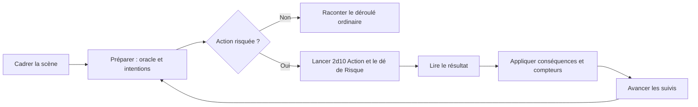

---
tags:
  - jdr
  - game-design
  - mecanique-de-des
  - solo-rpg
  - ironsworn
  - loner
  - resolution
aliases:
  - Système 4d10 Action et Risque
  - Résolution d10 Ironsworn-Loner
  - Action et Risque
created: 2026-11-23
---

# Système de résolution : 4d10 (Action et Risque)

> [!abstract] Concept clé
> Une mécanique de résolution hybride inspirée d'**Ironsworn** (comparaison directe entre dés d'action et de menace) et de **Loner** (modulateurs narratifs *"et..."* / *"mais..."* et gestion de l'avantage par pool de risque).
> Le système repose sur trois moteurs interdépendants : les **dés** (résoudre une action risquée), l'**oracle** (répondre aux questions du joueur) et l'**imprévu** (injecter de la tension que le joueur ne contrôle pas).

## 0. Vision d'ensemble : la boucle solitaire

La boucle de jeu se joue en cinq gestes, répétés à volonté au fil d'une scène :

1. **Cadrer** : établir le lieu, l'intention du personnage, la menace en présence.
2. **Préparer** : consulter l'oracle quand la réponse est incertaine ; noter les pistes ouvertes.
3. **Risquer** : quand l'issue est incertaine et qu'un prix à payer existe, déclencher la résolution.
4. **Conséquences** : braquer la caméra sur le coût, pas seulement sur la réussite.
5. **Progresser** : marquer les jalons, cocher les cases, laisser la fiction escalader.

> [!tip] Règle d'or du solo
> Le joueur n'est pas l'avocat du personnage. Lors d'un Coup faible ou d'un Échec, la première source de conséquence doit être la menace établie dans la fiction, jamais une échappatoire inventée après le jet.

## 1. Matériel requis

* **2d10 d'Action** (couleur claire ou positive).
* **2d10 de Risque** (couleur sombre ou négative).
* **1d100** (ou 2d10 lisibles en dizaines et unités) pour l'oracle.
* Une **feuille de personnage sans statistiques** : étiquettes, compteurs, suivis (voir section 2).
* Des **cases de suivi** dessinées ou cochables : lignes de dix cases pour les vœux et divers compteurs.
* Un espace de narration : carnet, log de session ou outil d'écriture.

## 2. Le personnage : une feuille sans chiffres

Le système ne comporte aucune caractéristique chiffrée. La compétence du personnage s'exprime par la fiction : c'est le **positionnement** qui ajoute ou retire un dé de Risque, jamais une valeur de talent.

### 2.1 Étiquettes (3 à 5)

Décrire le personnage par des fragments évocateurs plutôt que par des capacités mécaniques. Exemples : *Cartographe disgracié*, *Lame heurtée mais sûre*, *Mauvaise réputation bien gagnée*, *Chemine toujours de nuit*.

Rôle des étiquettes :

* Justifier un **Avantage** quand elles sont pertinentes et activées par la fiction.
* Provoquer un **Désavantage** quand elles jouent contre le personnage (une *Mauvaise réputation* dans la ville qui la connaît).
* Servir de respiration narrative : une étiquette qui n'a jamais posé de problème ni ouvert de porte mérite d'être remplacée lors de la progression.

### 2.2 Compteurs (4 cases chacun)

Deux compteurs individuels, cochés de gauche à droite :

* **Vigueur** : intégrité du corps, endurance, santé.
* **Volonté** : moral, lucidité, détermination.

Décocher une case compte comme **encaisser un coup**. Certains coûts imposent lequel des deux compteurs est touché ; sinon le joueur choisit, sauf si la fiction tranche évidemment (une chute touche la Vigueur, une révélation accablante touche la Volonté).

Lorsqu'un compteur tombe à **zéro**, le personnage subit un **État** persistant (voir section 7) et voit toute action en rapport avec ce compteur se jouer en **Désavantage** jusqu'à récupération.

### 2.3 Équipement et liens

Notés en quelques lignes fictives, sans encodage mécanique. Un objet majeur pertinent peut justifier l'Avantage une fois par scène ; un lien vivant peut être mis à contribution pour décaler un coût (à la discrétion du joueur, au prix d'une marque de dette consignée dans le carnet).

## 3. Procédure de résolution

### Étape 1 : Constitution de la réserve

Selon le positionnement fictionnel du personnage, on détermine le nombre de **dés de Risque** lancés :

* **Position normale :** Lancer **2d10 d'Action** et **1d10 de Risque**.
* **En Avantage :** Lancer **2d10 d'Action** et **2d10 de Risque**, puis **conserver uniquement le dé de Risque le plus faible**.
* **En Désavantage :** Lancer **2d10 d'Action** et **2d10 de Risque**, puis **conserver uniquement le dé de Risque le plus fort**.

### 3.1 Quand positionner en Avantage ou Désavantage

| Source d'Avantage (exemples)                 | Source de Désavantage (exemples)                  |
| :------------------------------------------- | :------------------------------------------------ |
| Préparation, repérage, temps de faire        | Action précipitée, surprise, pression du temps    |
| Outillage ou équipement vraiment pertinent   | Objet inadapté, cassé, manquant                   |
| Étiquette activée par la scène               | Étiquette qui se retourne contre le personnage    |
| Position dominante : haut, couvert, entrain  | Position dominée : au sol, exposé, acculé         |
| Rapport de force favorable, allié disponible | Rapport de force défavorable, supériorité adverse |
| Situation connue, familière                  | Situation obscure, milieu hostile                 |

Règles d'arbitrage :

* **L'Avantage et le Désavantage s'annulent mutuellement** : chaque source d'Avantage neutralise une source de Désavantage, et un solde net de zéro équivaut à la Position normale. Il ne faut jamais cumuler.
* Le positionnement se décide **avant le lancer**, à voix haute, en une phrase résumant pourquoi la fiction pèse d'un côté.
* En cas de doute, jouer la **Position normale**.

### Étape 2 : Lecture du résultat principal

On compare individuellement chacun des deux **dés d'Action** au **dé de Risque** retenu :

| Condition                                                                | Résultat        | Effet narratif                                                                 |
| :----------------------------------------------------------------------- | :-------------- | :----------------------------------------------------------------------------- |
| Les **2 dés d'Action** sont **$\ge$** au dé de Risque                    | **Coup fort**   | L'action réussit pleinement, sans coût ni complication majeure.                |
| **1 seul dé d'Action** est **$\ge$** au dé de Risque *(l'autre est $<$)* | **Coup faible** | L'action réussit, mais avec un coût, un compromis ou un danger imminent.       |
| Les **2 dés d'Action** sont **$<$** au dé de Risque                      | **Échec**       | L'action échoue ou la situation tourne nettement au désavantage du personnage. |

*Si l'on souhaite rendre une tâche légèrement plus difficile, on peut décider d'un échec sur une égalité plutôt que strictement inférieur.*

> [!note] Lecture des dés d'Action
> Les deux dés d'Action ne proposent pas deux essais successifs : ils se lisent **en parallèle**. Un seul dé suffit à porter la réussite, mais un dé à la traîne laisse le personnage exposé, d'où le format "réussite avec prix" du Coup faible.

### Étape 3 : Modulateurs narratifs (Doubles et Égalités)

Après avoir déterminé le résultat principal, on vérifie la présence de coïncidences numériques. Ces deux effets **peuvent se cumuler** (1 % de chance).

* **Critique ("et...") :** Les **2 dés d'Action affichent le même chiffre**.
  * *Sur un Coup fort :* Succès éclatant, opportunité supplémentaire ou avantage décisif (*"Oui, et..."*).
  * *Sur un Échec :* Catastrophe, aggravation brutale de la situation (*"Non, et..."*).
  * *Note mathématique :* Un critique est impossible sur un Coup faible, car deux dés identiques sont forcément tous les deux $\ge$ ou tous les deux $<$ au dé de Risque.
* **Inattendu ("mais...") :** Au moins **un dé d'Action est égal au dé de Risque**.
  * *Sur un Coup fort :* Succès complet, **mais** un élément imprévu surgit, un détail change la donne ou un rebondissement survient (*"Oui, mais..."*).
  * *Sur un Coup faible :* Succès mitigé, **mais** la nature du rebondissement est imprévisible ou ouvre une piste inattendue.
  * *Note mathématique :* Un inattendu est impossible sur un Échec, car l'égalité avec le dé de Risque compte déjà comme une réussite ($\ge$).
* **Double coïncidence ("et... mais...") :** Les 3 dés retenus affichent exactement la même valeur (ex. : `7` et `7` contre un risque de `7`). C'est toujours un **Coup fort** accompagné d'un retournement majeur.

Interprétation narrative :

* Le **Critique** intensifie ce que le jet dit déjà : il aggrave ou embellit la même ligne de fiction.
* L'**Inattendu** dévie : il ajoute une information nouvelle, un tiers, un indice ou une contrainte qui n'était pas dans l'équation. Tirer une inspiration sur les tables d'imprévus si l'idée ne vient pas.
* La **Double coïncidence** brouille la frontière : le jamais-vu devient pivot de la scène, voire de l'arc.

### Étape 4 : Payer les conséquences

Le résultat sec ne suffit pas : la conséquence doit être nommée et incarnée dans la scène.

* **Coup fort :** la réussite s'installe. Marquer les jalons mérités, fermer la tension ouverte si le but de l'action la couvrait.
* **Coup faible :** le joueur choisit une conséquence parmi :
  1. **Encaisser** : décocher une case de Vigueur ou de Volonté ;
  2. **Subir un revers narratif** : perdre du temps, du matériel, une piste, une faveur, une position durement gagnée ;
  3. **Ouvrir une menace** : la complication prend vie et se manifestera dans une scène future (consigner la promesse de GM dans le carnet).
  Si la fiction impose clairement une de ces conséquences, elle s'applique d'office, sans choix.
* **Échec :** la menace se réalise au minimum : le personnage n'obtient pas ce qu'il voulait, et décoche une case (prolongé par un État si un compteur tombe à zéro). Un Critique d'échec ajoute une seconde conséquence d'égale gravité, en escaladant : la menace gagne du terrain, un tiers entre en scène, une ressource disparaît.

> [!warning] Escalade des échecs
> Ne jamais payer deux fois le même prix. Si l'Échec a déjà coûté une case de compteur, la conséquence d'escalade doit porter sur la situation (l'adversaire, le lieu, le calendrier), pas sur le personnage.

## 4. Quand lancer les dés, et quand s'en passer

* **Lancer la résolution** seulement si les trois conditions sont réunies :
  1. L'issue d'une action est **réellement incertaine** ;
  2. Il existe une **menace en scène ou en off**, fût-elle minimale (le temps, la confiance des autres, l'intégrité physique) ;
  3. L'échec ou le compromis **ferait avancer l'histoire**, pas seulement la retarder.
* **Ne pas lancer** et raconter simplement : quand la fiction rend l'issue évidente (traverser un couloir tranquille, reconnaître un ancien camarade), ou quand ni réussite ni échec n'ont de poids.
* **Consulter l'oracle** : quand la réponse appartient au monde (un PNJ est-il présent, la porte est-elle verrouillée, la piste est-elle bonne) et que ni la logique ni la fiction ne la donnent. L'oracle répond au monde ; les dés répondent aux enjeux.
* Enchaîner plusieurs actions anodines ne relève pas de plusieurs jets : un unique jet couvre la séquence, la position de départ tenant compte des préparatifs.

## 5. Suivis et progression (moteur Ironsworn)

### 5.1 Vœux et jalons

Le personnage porte un à trois **vœux** majeurs (commander la campagne, réparer l'honneur d'un nom, retrouver une personne disparue). Chaque vœu possède une **ligne de dix cases**.

* Cocher une case par **jalon significatif** franchi : information décisive, victoire durement payée, alliance scellée, zone traversée contre le danger.
* Une scène rythmée par des échecs payés au prix fort marque souvent un jalon ; une scène tranquille n'en marque aucun.
* Quand la dixième case est cochée, déclencher la **Clôture du vœu** : jouer la scène de résolution en fiction, puis lancer la résolution en **Avantage** (2d10 d'Action contre le minimum de 2d10 de Risque), en résumant tout le chemin parcouru.
  * **Coup fort :** le vœu aboutit tel qu'espéré ; transformer l'issue en départ de vœu suivant.
  * **Coup faible :** le vœu aboutit, mais il en coûte au personnage ou à son monde ; la réussite a laissé des cicatrices.
  * **Échec :** le vœu échoue ou se retourne ; en hériter d'un vœu plus sombre, ou payer le prix en comprimant ses moyens (case décochée, État, dette).

### 5.2 Expérience et évolution

En fin de session (ou de séquence de jeu notable), attribuer **1 point d'expérience** par moment marquant, dans la limite de deux par session :

* un moment payé cher (Coup faible ou Échec incarné avec conviction) ;
* un jalon de vœu coché ;
* un État assumé plutôt qu'esquivé.

Dépense (chacune coûte 2 points, sauf mention contraire) :

* **3 points** : ajouter ou réécrire une étiquette ;
* **2 points** : recocher toutes les cases d'un compteur de son choix ;
* **2 points** : transformer un revers subi en ressource (une dette devient une faveur, une blessure devient une leçon incarnée, notée en une ligne).

## 6. Combat, poursuites et dangers

Pas de rounds ni d'initiative : tout affrontement est une **scène de fracas** résolue par la résolution standard.

* Décrire une **manœuvre à la fois** (désarmer, franchir, protéger, semer) et la résoudre par un jet. Chaque jet est une prise, pas un échange de coups.
* **Coup faible** et Échec en combat se paient en Vigueur en priorité ; un ennemi n'a pas de compteur : sa défaite prend corps dans la fiction par les jets réussis successifs (désarmé, terrassé, en fuite) ou par un Coup fort décisif qui ouvre la voie au coup de grâce.
* Une **poursuite** se joue en un à trois jets : distance initiale (positionnement), incident de parcours, sprint final. Le vainqueur des jets éjecte le vaincu hors scène, ou l'accule à la scène suivante.
* Un ennemi de plus grande envergure (rival, monstre récurrent) quitte la scène blessé ou frustré plutôt que vaincu, sauf Clôture de vœu : les rivaux sont un moteur, pas un point de vie.

## 7. États et récupération

| État (compteur à zéro) | Effet en jeu                                                                      | Exemples de sortie                                 |
| :--------------------- | :-------------------------------------------------------------------------------- | :------------------------------------------------- |
| **Blessé** (Vigueur)   | Actions physiques en Désavantage ; déplacer, porter et combattre coûtent une case | Soins, repos sûr, plusieurs jours de convalescence |
| **Épuisé** (Vigueur)   | Actions d'endurance en Désavantage                                                | Nuit complète, repas, répit sans menace            |
| **Troublé** (Volonté)  | Actions de sang-froid, persuasion et repérage mental en Désavantage               | Réconfort, vérité confrontée, contre-poison moral  |
| **Abattu** (Volonté)   | Assumer un revers, résister à la peur, espérer en Désavantage                     | Vœu renouvelé et nommé à voix haute, lien ranimé   |

Récupérer un État exige une **scène dédiée** au calme, un jet de résolution ou le paiement d'expérience (section 5.2). Un État ne se soigne jamais en scène de tension.

## 8. Fin de session

1. **Délier les fils** : relire les promesses de GM consignées (menaces ouvertes, pistes, dettes ; ouvrir un carnet froid si nécessaire).
2. **Levée de rideau** : noter où s'arrête la scène, en une phrase d'ambiance.
3. **Attribuer l'expérience** (section 5.2).
4. **Journal du personnage** : une phrase à la première personne sur ce qui a changé. Cette phrase devient l'amorce de la prochaine session.

## 9. Oracle

Lorsque vous cherchez à résoudre des questions, découvrir des détails, révéler des lieux, déterminer comment d'autres personnages réagissent, ou déclencher des rencontres ou des événements, vous pouvez...
- Tirer une conclusion : décidez de la réponse en vous basant sur le résultat le plus intéressant et le plus évident.
- Susciter une idée : utilisez une table d'oracle ou une autre invite aléatoire.
- Poser une question fermée : décidez des probabilités d'un "oui", et lancez les dés sur la table ci-dessous pour vérifier la réponse.
- Choisir entre deux : imaginez deux options. Considérez l'une comme "probable", et lancez les dés sur la table ci-dessous pour voir si c'est vrai. Sinon, c'est l'autre.

| Chances                | Oui Critique |  Oui  |  Non  | Non Critique |
| :--------------------- | :----------: | :---: | :---: | :----------: |
| **Certain**            |     1–18     | 19–90 | 91–98 |    99–100    |
| **Presque certain**    |     1–17     | 18–85 | 86–97 |    98–100    |
| **Très probable**      |     1–15     | 16–75 | 76–95 |    96–100    |
| **Probable**           |     1–13     | 14–65 | 66–93 |    94–100    |
| **50/50 ou Inconnu**   |     1–10     | 11–50 | 51–90 |    91–100    |
| **Improbable**         |     1–7      | 8–35  | 36–87 |    88–100    |
| **Très improbable**    |     1–5      | 6–25  | 26–85 |    86–100    |
| **Presque impossible** |     1–3      | 4–15  | 16–83 |    84–100    |
| **Impossible**         |     1–2      | 3–10  | 11–82 |    83–100    |
En cas de double, c'est un Inattendu ("mais...").

Lecture des quatre issues :

* **Oui Critique** : "Oui, et..." ; le facteur favorable dépasse la question, déclenche parfois une piste ou une rencontre à exploiter.
* **Oui** : l'affirmative sèche, à incarner avec le plus de détails concrets possible.
* **Non** : la négative sèche ; on ne relance pas pour la même question sous le même angle.
* **Non Critique** : "Non, et..." ; la négative s'accompagne d'une complication, d'une révélation défavorable ou d'un coût d'entrée.

Choisir la ligne de chances avant le jet, à partir de trois critères : vraisemblance fictionnelle, ce que le récit a besoin d'être *dramatiquement*, et ce que le monde contient déjà. Si l'oracle répond "Non" à un élément que la fiction a déjà établi, c'est la fiction qui gagne : l'oracle ne peut jamais contredire un fait en scène.

> Version simple:
Probabilités : La réponse est "oui" si vous obtenez...
- Faible chance : 10 ou moins
- Peu probable : 25 ou moins
- 50/50 : 50 ou moins
- Probable : 75 ou moins
- Presque certain : 90 ou moins
En cas de correspondance (double), imaginez un résultat extrême ou un rebondissement.

## 10. Imprévu

À chaque début de session ou tour de scène significatif, faire un jet d'oracle, en adaptant les chances à la situation. En cas de **Oui Critique**, un événement imprévu se produit. Adapter à la narration ou lancer sur le tableau ci-dessous pour inspiration :

| Jet (d100) | Type d'événement          |
| ---------- | ------------------------- |
| 1-7        | Événement distant         |
| 8-28       | Action PNJ                |
| 29-35      | Introduire un nouveau PNJ |
| 36-45      | Avancer dans une piste    |
| 46-52      | Changer de piste          |
| 53-55      | Fermer une piste          |
| 56-67      | PJ négatif                |
| 68-75      | PJ positif                |
| 76-83      | Événement ambigu          |
| 84-92      | PNJ positif               |
| 93-100     | PNJ négatif               |

Usage :

* **Début de session** : un seul jet, pour installer la tension ambiante de la séance.
* **Entre les scènes** ou en cas de scène qui s'étiole : relancer pour faire respirer le monde.
* Un jet d'Imprévu ne peut **jamais** annuler une conséquence déjà payée : il se superpose, il ne réécrit pas.

## 11. Tables de probabilités exactes

### Vue d'ensemble des résultats

| Résultat / Modulateur            | Désavantage *(garder le max)* | Normal *(1d10 risque)* | Avantage *(garder le min)* |
| :------------------------------- | :---------------------------: | :--------------------: | :------------------------: |
| **Coup fort**                    |            20,35 %            |      **38,50 %**       |          56,65 %           |
| **Coup faible**                  |            36,30 %            |      **33,00 %**       |          29,70 %           |
| **Échec**                        |            43,35 %            |      **28,50 %**       |          13,65 %           |
| *Total réussite (Fort + Faible)* |           *56,65 %*           |     ***71,50 %***      |         *86,35 %*          |
| **Critique ("et...")**           |            10,00 %            |      **10,00 %**       |          10,00 %           |
| **Inattendu ("mais...")**        |            19,00 %            |      **19,00 %**       |          19,00 %           |
| **Critique + Inattendu**         |            1,00 %             |       **1,00 %**       |           1,00 %           |

### Lecture croisée résultat et modulateur (position normale)

| Issue finale            | Fréquence | Tonalité dominante                  |
| :---------------------- | :-------: | :---------------------------------- |
| Coup fort sec           |   24 %    | Triomphe net                        |
| Coup fort + Critique    |   4,5 %   | Oui, et... (porte ouverte)            |
| Coup fort + Inattendu   |    9 %    | Oui, mais... (rebondissement positif) |
| Coup faible sec         |   24 %    | Réussite au prix fort               |
| Coup faible + Inattendu |    9 %    | Compromis teinté d'incertitude      |
| Échec sec               |   24 %    | Revers net                          |
| Échec + Critique        |   4,5 %   | Non, et... (catastrophe)              |
| Double coïncidence      |    1 %    | Pivot de session                    |

## 12. Notes de conception (Design Notes)

* **Stabilité des rebondissements :** Quelle que soit la difficulté (Avantage, Normal ou Désavantage), la fréquence globale des rebondissements reste constante (10 % de Critiques, 19 % d'Inattendus, 28 % d'événements spéciaux au total). Seule leur orientation positive ou négative bascule.
* **Symétrie parfaite :** L'Avantage et le Désavantage sont des miroirs mathématiques exacts (56,65 % de Coup fort en Avantage contre 20,35 % en Désavantage ; 13,65 % d'Échec contre 43,35 %).
* **Équilibre sans modificateur :** En position normale, les trois issues "sèches" (sans *et* ni *mais*) ont exactement la même probabilité d'apparition : **24 %** chacune.
* **La compétence est un positionnement, pas un chiffre :** supprimer les caractéristiques déplace toute la charge vers le cadrage fictionnel ; la règle d'annulation Avantage/Désavantage (section 3.1) évite l'écueil du cumul de bonus et garde la lecture du jet en trois lignes.
* **Design des 28 % d'événements spéciaux :** un jet sur trois à quatre fait bouger la fiction au-delà de l'action elle-même ; c'est le dosage qui rend les sessions solitaires vivantes sans sombrer dans le chaos.
* **Compteurs à quatre cases :** assez courts pour que les coups se ressentent assez tôt, assez longs pour qu'une session type ne tourne pas au délabement permanent.
* **Ce que le système ne code pas :** les PNJ, les lieux, les richesses. Tout vit en fiction et se résout par l'oracle et les jets ; les tables viendront compléter les manques dans les fiches dédiées.

## 13. Fiches liées (à venir)

Les tables aléatoires détaillées seront hébergées hors de cette fiche :

* [[Tables - Imprévus détaillés]]
* [[Tables - PNJ et motivations]]
* [[Tables - Pistes et enquête]]
* [[Tables - Décors et atmosphère]]
* [[Tables - Coûts, revers et dettes]]
* [[Tables - Événements distants et rumeurs]]
